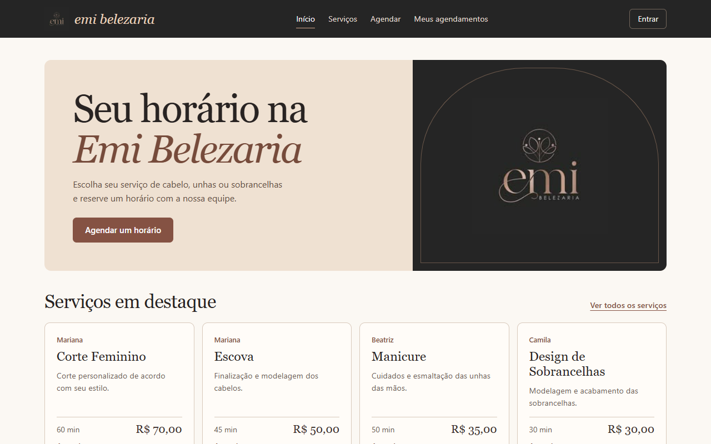
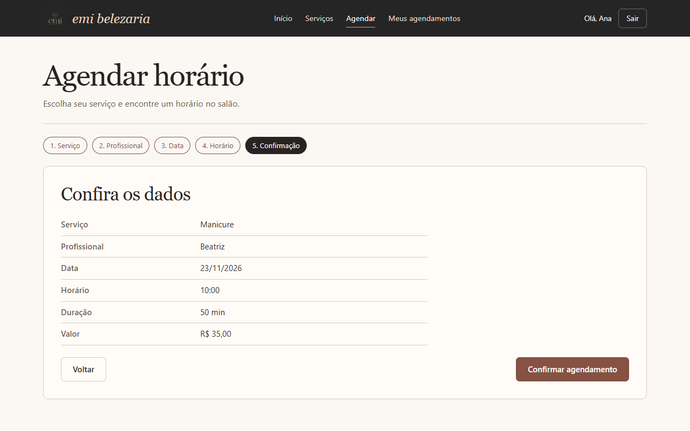
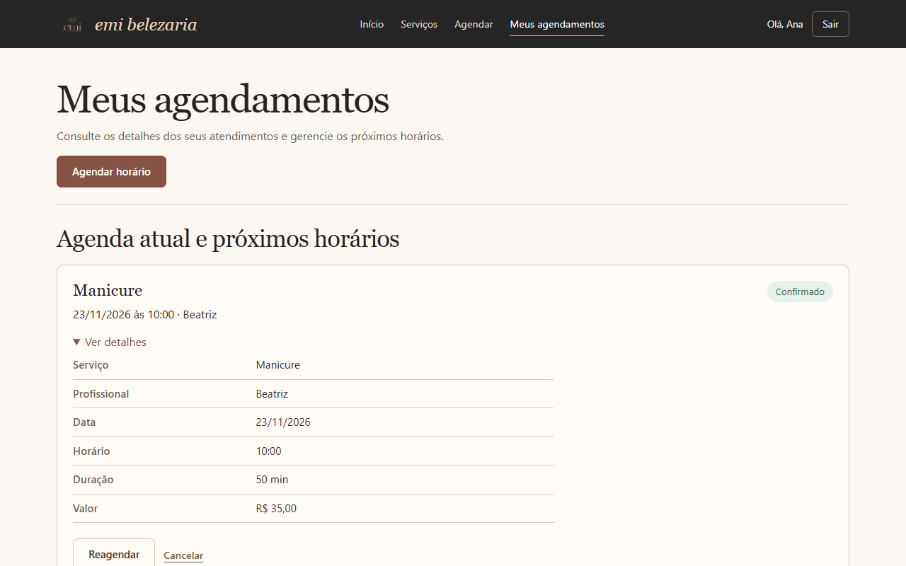

# Emi Belezaria

Sistema de agendamento desenvolvido para a entrega final do PIC I. O objetivo é permitir que a cliente consulte os serviços do salão, encontre um horário disponível e gerencie as próprias reservas. O catálogo pode ser consultado antes do cadastro.

**Integrantes:** Gabriel Gonzales Azevedo Noronha e Felipe Proença.



## Executar o projeto

Você precisa de Python 3.9 ou superior com a biblioteca padrão e de um navegador atualizado com JavaScript e cookies habilitados. O sistema roda no computador do avaliador. Não há pacotes a instalar com pip ou npm, nem contas externas a configurar.

1. Extraia o ZIP inteiro. Se estiver usando o GitHub, clone o repositório ou extraia o ZIP obtido em **Code → Download ZIP**.
2. Abra o terminal na pasta que contém `servidor.py`. No Windows, execute:

   ```powershell
   py -3 servidor.py
   ```

   Se a instalação disponibilizar o comando `python`, use `python servidor.py`. No macOS ou Linux, use `python3 servidor.py`.

3. Abra **[http://127.0.0.1:8000/](http://127.0.0.1:8000/)** no navegador. Mantenha o terminal aberto durante a avaliação. Para encerrar, pressione **Ctrl+C**.
4. Clique em **Entrar → Criar uma conta**. Informe um nome, um e-mail e uma senha de 8 a 128 caracteres. A nova conta inicia com a agenda vazia.

O servidor cria o banco `dados/agenda.sqlite3` no primeiro uso. Reutilize a mesma pasta para preservar os dados entre execuções. Para usar outra porta ou um banco separado, execute, por exemplo, `python servidor.py --porta 8081 --banco dados/avaliacao.sqlite3` e abra o endereço mostrado no terminal. Se abrir um arquivo HTML com duplo clique, a API ficará indisponível. Acesse o endereço HTTP indicado acima.

## Experimentar uma reserva

1. No catálogo **Serviços**, procure **Manicure** e clique em **Agendar**. Se precisar entrar ou se cadastrar, você retorna à marcação com Manicure selecionada.
2. Avance, selecione **Beatriz** e escolha uma data futura de segunda a sábado.
3. Consulte os horários livres, escolha um e clique em **Revisar**. O resumo da manicure mostra **50 minutos** e **R$ 35,00**.
4. Confirme e abra **Ver meus agendamentos**. Em **Ver detalhes**, confira o serviço, a profissional e a data. Atualize a página para verificar que a reserva foi salva.
5. Use **Reagendar** para trocar a data ou o horário. Depois, em **Cancelar → Confirmar cancelamento**, envie o registro ao histórico. O intervalo volta a aparecer para uma nova reserva se ainda estiver disponível.



## Funcionalidades e regras

- Catálogo de sete serviços nas áreas de cabelo, unhas e sobrancelhas, com preço, duração e profissional responsável.
- Cadastro, login e saída. Cada cliente consulta e altera suas próprias reservas.
- Reserva em cinco etapas, com validação da especialidade, da data e da disponibilidade pelo servidor.
- Para esta versão acadêmica, o atendimento ocorre de segunda a sábado, das **9h às 18h**, com inícios a cada **30 minutos** e antecedência máxima de **90 dias**. O relógio local do servidor determina o dia e a hora.
- Cada serviço ocupa toda a sua duração. Uma cliente ou profissional pode ter apenas uma reserva por intervalo, inclusive quando duas solicitações chegam ao mesmo tempo.
- A tela inicial exibe a próxima reserva confirmada. A área **Meus agendamentos** reúne os horários futuros, em andamento e o histórico. O encerramento é calculado pelo horário previsto. Cancelamento e reagendamento estão disponíveis até o início do atendimento.
- Layout adaptável a computador e celular. Depois de iniciar o servidor, toda a interface funciona sem carregar recursos da internet.



## Tecnologias e organização

| Arquivo ou pasta | Responsabilidade |
| --- | --- |
| `index.html`, `servicos.html`, `login.html` | Página inicial, catálogo e acesso à conta |
| `agendar.html`, `agendamentos.html` | Marcação e gerenciamento das reservas |
| `style.css`, `assets/` | Layout responsivo e identidade visual do salão |
| `script.js`, `agenda.js` | Interface, navegação e chamadas à API JSON |
| `servidor.py` | Servidor HTTP Python, autenticação e acesso ao SQLite |
| `agenda.py` | Catálogo, expediente, horários disponíveis e transações de reserva |
| `testes/test_agenda.py` | Testes de integração HTTP usando bancos temporários |
| `docs/` | Capturas reais da aplicação para este README |

O servidor escuta em `127.0.0.1`. A conta é autenticada por um cookie de sessão com validade de oito horas. As senhas são armazenadas usando PBKDF2 com sal individual. O banco de uso local fica fora do controle de versão.

## Verificar o funcionamento

Na pasta de `servidor.py`, execute:

```sh
python -B -m unittest discover -s testes -v
```

Use `py -3` ou `python3` no lugar de `python` conforme a instalação. A suíte inicia seus próprios servidores locais e usa bancos SQLite temporários. Os nove testes cobrem o catálogo, a autenticação, o isolamento entre clientes, dados inválidos, criação e cancelamento, sobreposição por duração, disputa simultânea, reagendamento com conflito e persistência após reiniciar.

Na avaliação da entrega, os nove testes passaram. O fluxo de cadastro, consulta, confirmação, reagendamento, cancelamento e novo login também foi percorrido no Chrome, com verificação da navegação em largura de celular.
